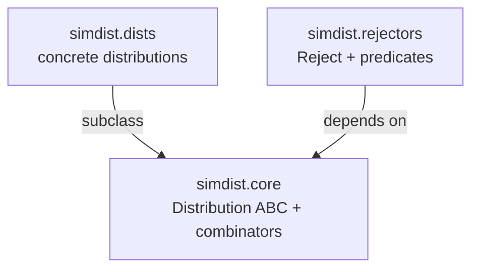
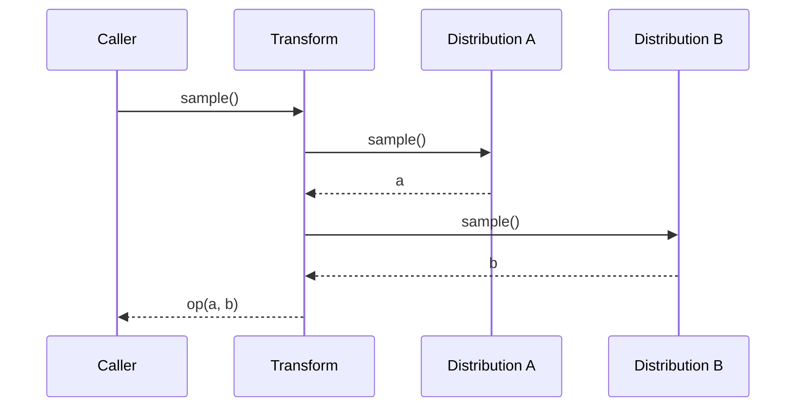
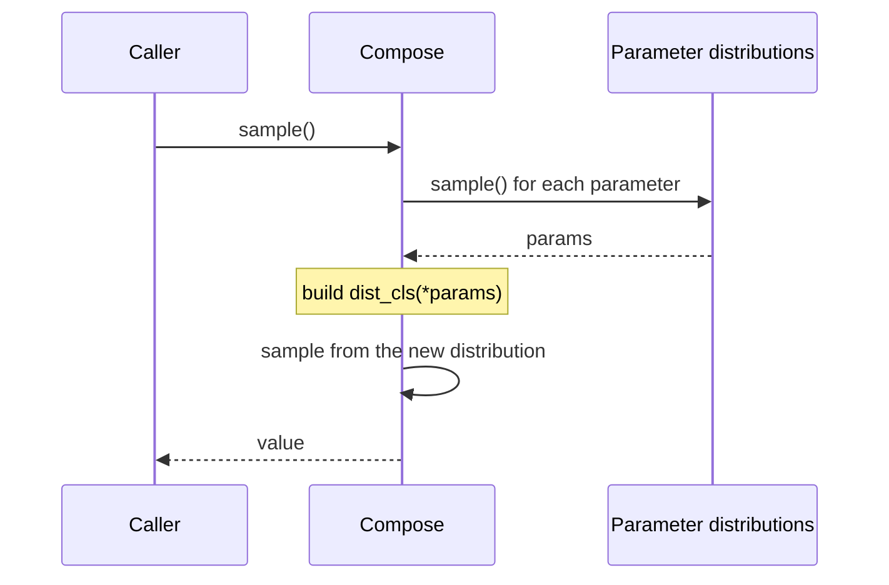

# Architecture

SimDist is a thin, uniform layer over a collection of distributions and a
handful of ways to combine them. This page explains how the pieces fit
together.

## The three modules



- **`core`** knows nothing about any specific distribution. It defines the
  `Distribution` interface and the combinators that treat distributions as
  opaque objects with a `sample` method.
- **`dists`** depends on `core` and provides the concrete distributions.
- **`rejectors`** depends only on `core`.

The dependency arrows point in one direction. Nothing in `core` imports from
`dists`, which is what keeps the combinators general.

## The sampling contract

Everything revolves around one method:

```python
def sample(self, context=None):
    ...
```

A distribution is anything that can produce a value. The optional `context`
carries simulation state, so a distribution can depend on the wider simulation
without knowing about it at construction time. The built-in distributions
ignore `context`, but `Degenerate` and user-defined distributions can use it.

The base class layers everything else on top of `sample`:

- `batch_sample` calls `sample` repeatedly.
- The arithmetic operators build a new distribution whose `sample` calls the
  operands' `sample`.
- `Compose` and `FiniteMixture` likewise defer to their components.

Because all composition is expressed in terms of `sample`, you can nest it
arbitrarily.

## How composition flows

A plain call to `sample` on a `Transform` triggers a small tree of draws:



`Compose` adds one more step: it samples the *parameters*, constructs a new
instance, and then samples from that instance.



## Special-cased arithmetic

Most arithmetic falls back to `Transform`, but a distribution may override an
operator when a closed form exists. `Poisson` overrides `__add__` so that the
sum of two Poisson distributions is another `Poisson` with the summed rate.
When an override does not apply, it delegates to the base class with
`super().__add__(other)`.

This pattern keeps the general mechanism (`Transform`) as the default while
allowing exact structure to be preserved where it is known.

## Moments and the `NotImplementedError` fallback

The base class does not attempt to infer moments. Every moment method raises
`NotImplementedError` unless a distribution implements it. This is deliberate:
for a `Transform` or a `Compose`, the moments may not have a closed form, and
silently returning a wrong value would be worse than a clear error.

Some distributions report that a moment is undefined by raising `ValueError`
instead. `Cauchy.mean()` is undefined for every parameterisation, and
`StudentT.mean()` is undefined when `df <= 1`; both raise `ValueError` to say
so explicitly.
